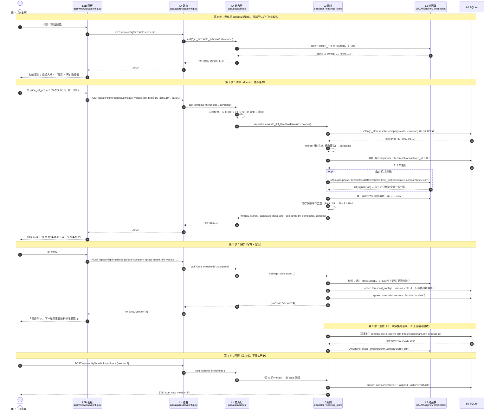
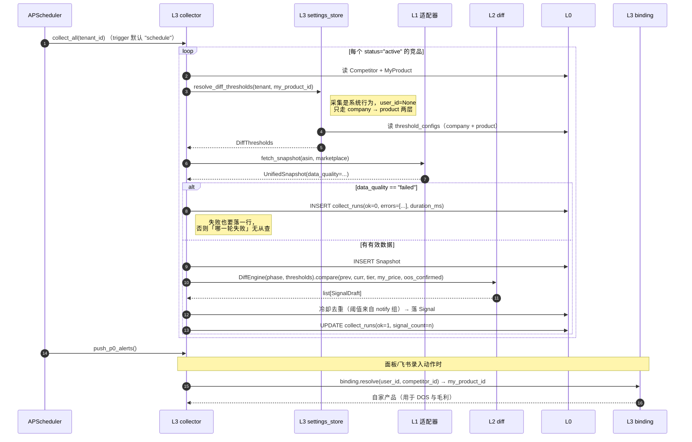
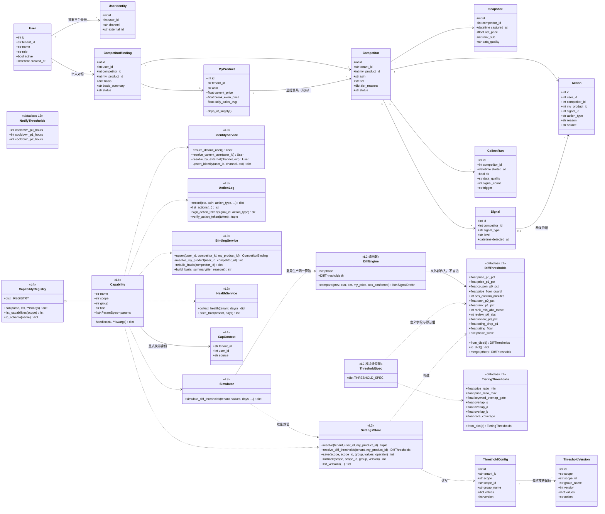
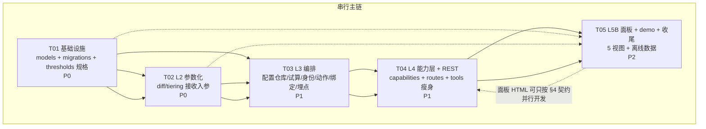

# MVP 增量设计（v5 六层 · 只做六块）

> 版本：MVP-1 ｜ 作者：高见远（架构） ｜ 基线代码：6133 行 / 31 个领域测试全绿 / 已有 10 张表
>
> **这是一份增量设计，不是重写方案。** 凡是现有代码能撑住的，一律不动；凡是必须改的，改法都选「加参数、加列、加文件」而不是「改语义、改契约、拆文件」。
>
> 三条贯穿全篇的判断依据（出现分歧时以此裁决）：
> 1. **两个前端共用一份实现**：飞书和面板不许各写一套查询逻辑。
> 2. **判断必须在 L2，配置必须从外部传入**：L2 里出现 `import sqlalchemy` 即视为设计错误。
> 3. **无数据也必须能演示**：任何新功能在「卖家精灵熔断 + bridge 未启动」时都要能在面板上看到东西。

---

# 一、增量设计说明

## 1.1 分层映射：v5 六层 → 具体文件

| 层 | 职责 | 现有文件 | 本轮新增/修改 |
|---|---|---|---|
| **L5A 交互·推送**（系统找人） | 飞书卡片 | `app/channels/*` | **不动**。飞书按钮回调只加一个 POST 端点，不碰现有渲染 |
| **L5B 交互·管理面板**（人找系统） | 五视图 HTML | `app/api/dashboard.py`（旧，保留） | **新增** `app/web/`（布局+5 视图源码拼装）+ `app/api/routes/panel.py` |
| **L4 能力层** | 两端共用的一组能力 | `app/agent/tools.py`（现兼工具注册表） | **新增** `app/capabilities/`（唯一实现）；`tools.py` 退化为薄适配层；**新增** `app/api/routes/`（REST 出口） |
| **L3 编排层** | 开会话、串联多步 | `app/services/{pool,collector,briefer,scheduler}.py` | **新增** `settings_store / simulator / identity / action_log / binding / health`；`collector.py`、`pool.py` 只做最小改动 |
| **L2 认知层** | 纯函数判断 | `app/domain/{diff,tiering,decision,baseline}.py` | **新增** `thresholds.py`（阈值规格，纯数据）；`diff.py`、`tiering.py` 接收入参 |
| **L1 取数层** | 只取数，不判断 | `app/adapters/*` | **不动**（`collector` 属于 L3 编排，只加埋点） |
| **L0 存储层** | ORM + 迁移 | `app/db.py`、`app/models.py` | `models.py` 加 5 张新表 + `Action` 加 5 列；**新增** `app/migrations.py` 幂等迁移 |

### 为什么这么放

- **阈值规格（`app/domain/thresholds.py`）放 L2 而不是放服务层**：它同时被 `diff` 和 `tiering` 使用；放进任一领域文件都会造成 `diff ↔ tiering` 互相 import。它只含 dataclass + 一张 `THRESHOLD_SPEC` 元数据表（键、中文名、类型、默认值、范围），**零 I/O、零时钟**，所以它仍属于 L2，L0/L4 都可以安全地 import 它 —— 这是「配置从外面传」这条红线能落地的关键：**同一份 schema 定义，服务端用它存、面板用它渲染表单、L2 用它构造 dataclass。**
- **能力层独立成 `app/capabilities/` 而不是继续塞 `tools.py`**：`tools.py` 现在的 `TOOL_SCHEMAS` 是「给模型看的说明书」，参数描述、枚举、必填项都为了 LLM 理解而写。面板需要的是「中文标签 + 类型 + 范围」，两者诉求不同。把实现抽出来，`tools.py` 只保留 schema 和参数整形，**两边的差异留在各自的适配层，共性沉到能力层**。
- **面板源码拆成多文件、产物仍是单文件 HTML**：硬约束是「不引入 npm / 构建链」，这约束的是**浏览器侧**，不是服务端。HTML 由 Python 拼装后一次性返回，浏览器只收到一个自包含 HTML（零外部请求、零 CDN）。拆源码是给人维护的，不影响产物。现有 `dashboard.py` 是 219 行单文件，五视图照抄这个写法会变成 ~900 行的一个字符串常量，改一处要滚动 900 行 —— 这是唯一一处我主动偏离「照抄现有风格」的地方，理由写在这里备案。
- **采集运行日志（`collect_runs`）必须新建**：现在采集失败时 `collector` 只 `_touch_checked()` 然后 return，**失败这件事没有任何落库痕迹**。数据健康视图要回答「哪一轮采集失败」，没有这张表就只能靠猜。这是本轮唯一为了「看得见」而新增的存储。

## 1.2 六块需求 → 设计结论（逐块）

### 块 1：L4 HTTP API 层 —— 让面板能调 LLM 能调的东西

**做法**：新建 `app/capabilities/`，用一个注册表把现有的 12 个能力（5 查询 + 5 写入 + 2 求签）加上本轮新增的 21 个，共 33 个，统一成 `Capability` 对象，唯一入口 `call(name, ctx, **kwargs) -> dict`。

**关键设计：`ctx` 显式携带身份，能力层不猜当前用户。**

```python
@dataclass(frozen=True)
class CapContext:
    tenant_id: str
    user_id: int | None          # None = 系统行为（定时采集），不是"忘了传"
    source: Literal["panel", "feishu", "agent", "system"]
```

这和 L2 的「不读时钟和环境变量」是同一条原则在 L4 的延续：**身份从外部传入，不在能力层里读全局状态**。否则面板切了用户、飞书还按旧用户算账，这类 bug 极难复现。

**能力分两类**：

| scope | 含义 | 谁能调 | 本轮清单 |
|---|---|---|---|
| `shared` | 两端共用 | 面板 REST + LLM 工具 + 飞书 | 查询类 14 个、写入类 13 个、求签类 4 个（见 §4.2） |
| `agent_only` | 对话专用（意图理解/上下文/转述） | 只有 Agent，面板调 `/api/cap/{name}` 直接 403 | `agent_chat`（委托 `llm.achat`）、`reset_context` |

**为什么 `agent_chat` 要进注册表却又不给 LLM 看**：它必须可被枚举（面板要能解释"为什么这个功能页面上没有"），但绝不能被放进 `TOOL_SCHEMAS` —— 否则模型会尝试调用自己，形成递归。这是本轮唯一一个「注册了但不暴露」的能力，用 `scope` 字段区分，不搞特例。

**`execute_tool` 契约不变**（红线）：

```python
def execute_tool(name: str, args: dict | None = None) -> dict:
    try:
        return capabilities.call(name, ctx=CapContext(settings.tenant_id, None, "agent"), **(args or {}))
    except CapabilityError as e:
        return {"ok": False, "error": e.message, "hint": e.hint}
    except Exception as e:
        logger.exception(...)
        return {"ok": False, "error": f"{type(e).__name__}: {e}"}
```

现有 `llm.py` 的 `execute_tool(name, args)` 调用点（`chat` / `achat` 各 1 处）一行都不用改。

### 块 2：L5B 管理面板 —— 五视图、单文件、零构建

**产物**：`GET /` 返回一段自包含 HTML（`app/web/panel.py::render_panel()`），内嵌原生 JS，仅使用 `fetch`，**页面内不允许出现任何 `http(s)://` 外链**（含 CDN、字体、图标）。样式变量与明暗主题直接沿用 `app/api/dashboard.py` 的 `:root` 那套。

**五个视图的加载独立性**：每个 tab 各自 `fetch` 各自渲染，某接口挂了只有该 tab 显示错误卡片，不影响其它 tab。原因很实际——数据源挂了的时候，用户最需要的恰恰是「数据健康」那一页，不能因为它旁边某页报错就整页白屏。

**前端与后端的契约靠 `GET /api/config/thresholds/schema`**：面板不认识任何阈值字段名，表单由 schema 动态生成。加一个可调参数 = 在 `THRESHOLD_SPEC` 加一行，面板自动出现该输入框，前端零改动。这是「零构建」能长期维护的前提。

**视图 ↔ 端点对照**：

| 视图 | 端点 | 回答什么问题 |
|---|---|---|
| ① 数据看板 | `GET /api/panel/board`、`GET /api/panel/competitors/{asin}/changes` | 我在盯谁、他现在什么价、最近动了什么、属于哪个战场 |
| ② 阈值配置 | `GET/POST /api/config/thresholds`、`.../simulate`、`.../versions`、`.../rollback`、`.../schema` | 现在按什么标准报警、改了会怎样、能回滚吗 |
| ③ 竞品池管理 | `GET /api/panel/pool`、`POST /api/panel/pool/{asin}/status`、`POST /api/bindings*` | 增/停/归档；为什么认为他跟我是同一个战场 |
| ④ 动作记录 | `GET/POST /api/panel/actions`、`POST /api/actions/callback` | 我做过什么、依据是什么、结果如何 |
| ⑤ 数据健康 | `GET /api/panel/health` | 哪一轮采集失败、哪几天价格不可信 |

**「价格不可信」怎么算（不需要新列）**：`Snapshot.net_price` 只可能由 promotions 接口写入（`collector.row_to_unified()` 正是靠这个等价关系反推 `price_source`）。因此 **`net_price IS NULL` 等价于「当轮价格不可知」**。按天聚合「net_price 为空的比例」就是价格可信度曲线。这个推论写进注释，避免后人误以为可以「补一个 0」。

### 块 3：阈值配置化（跨 L0/L3/L2）

**三层的分工，一句话讲清**：

```
L0  threshold_configs 表：只存"被覆盖的键"（稀疏），不存全量
L3  settings_store.resolve()：公司默认 → 个人覆盖 → 产品覆盖，合并出一份全量
L2  DiffEngine(phase, thresholds=...)：只认传进来的对象，RULES 降级为"默认值来源"
```

**为什么存稀疏而不是存全量**：存全量的话，`THRESHOLD_SPEC` 里加一个新参数，所有历史配置行都缺这个键，行为取决于「读的时候怎么兜底」——这是最容易埋雷的地方。存稀疏 + 读取时用 SPEC 默认值兜底，则「新增参数」天然兼容，且能明确回答「这个值是谁改的」（`sources` 字段标注每个键来自哪一层）。

**已声明但当前未被消费的常量也要进 SPEC**：`RULES["oos_confirm_minutes"]` 和 `tiering.CORE_COVERAGE` 现在都是「声明了但没人读」的死键（已 grep 确认）。它们**必须**一起搬进 `THRESHOLD_SPEC`，`help` 里注明「当前未直接消费，留作采集层确认窗口 / 词池口径」。理由很实际：如果跳过它们，下一个写采集确认逻辑的人会重新硬编码一个 30，而配置页上永远看不到它 —— 死键就是第二批"散落各处的魔法数字"的胚胎。

**`RULES` 不删，改注释角色**：从「运行时阈值」变成「默认值来源 + 迁移期兼容」。`DiffThresholds.from_dict()` 不传参时的默认值必须与 `RULES` 逐键相等，并写测试锁死 —— 这样 31 个测试的期望值不会漂移。

**回滚是「追加」而不是「改回」**：`threshold_versions` 只 append。回滚 = 用历史 `values` 走一次正常保存流程，`version = max+1`。理由：如果回滚去覆盖原行，「谁在什么时候把它改回去了」这件事就丢了，而这恰恰是配置类表最需要留痕的地方。

**必须说清的边界（裁定 #2 已定）**：定时采集是**系统行为，没有自然人**，因此采集时只走 `company + product` 两层，`user_id=None`。个人覆盖只在「面板试算」和「飞书里这个人问的结论」上生效。**「10 个人各按自己的阈值收不同的日报」本轮不做**，只做零成本伏笔：`briefer.build_daily_brief()` 预留 `user_id: str | None = None` 参数、内部暂时忽略，这样下一轮接 per-user 分发时不用改任何调用方。

### 块 4：动作记录（L0 + L4 + 面板）

`Action` 表已建但零使用。本轮启用，加 5 列（全部可空、纯追加）：

| 新列 | 为什么需要 |
|---|---|
| `user_id` | 「谁做的」——没有它，10 人共用就是一笔糊涂账 |
| `competitor_id` | 现有 `my_product_id` 只能定位到自家品；动作常常是"针对某个竞品"的 |
| `signal_id` | 「依据是什么」——把动作挂回触发它的那条信号 |
| `reason` | 人话依据（信号是机器写的，动作依据常是人补的） |
| `source` | `panel / feishu_card / agent / system`，用于区分录入渠道 |

**飞书按钮回调先预留**：`POST /api/actions/callback`，`token = f"{signal_id}.{action_type}.{hmac16}"`，`hmac16 = HMAC-SHA256(secret, f"{signal_id}.{action_type}").hexdigest()[:16]`。`ACTION_TOKEN_SECRET` 未配置时**直接拒绝（fail-closed）**而不是跳过校验 —— 一个能被随意伪造「老板已决定跟价」的端点，比没有这个端点危险得多。本轮不做卡片按钮渲染，只做「解析 + 写库」。

### 块 5：对标绑定表（L0）

**核心洞察（需求里已经点出来了，这里给落地方案）**：四同法则算出的 `tier_reasons` 本来就是绑定的依据，现在只用于筛选、没落库。所以绑定表里最关键的不是三个外键，而是 `basis` 这个 JSON 列 —— 它存下「当时为什么认为这两个是同战场」的**判定快照**，而不只是一个布尔结论。

```
competitor_bindings(user_id, competitor_id, my_product_id, basis JSON, source, confidence, status)
```

`basis` 内容 = `TieringResult.tier_reasons` + 判定时的阈值版本号 + 判定时间 + 参与计算的价格/词重合原始值。存阈值版本号的原因：**半年后回头质疑「为什么当初把这个 ASIN 判成 S」，没有当时的阈值就无法复现。**

**为什么是三元组而不是二元组**：同一个竞品，A 拿自家 A1 对标、B 拿自家 A2 对标（比如同时做两个价位段）。二元组会强行把两人挤到一行，后写覆盖先写。三元组 + `UNIQUE(user_id, competitor_id, my_product_id)` 才能共存。

**闭环的最小改动**：`judge_price_follow` 能力新增可选参数 `competitor_id`。传了就用绑定解析出自家的 `my_product` 和 `user`，没传就沿用现在的「取 tenant 第一个 MyProduct」。**默认行为一字不变**，所以 LLM 的调用方式和 31 个测试都不受影响。

### 块 6：用户身份（最小实现）

`users` + `user_identities`（`channel` 取 `feishu / wecom / dingtalk / web`）。**不做登录系统**。

**当前用户怎么确定（无状态方案，不用进程内存）**：

1. 面板把选择存 `localStorage`，每个请求带 `X-User-Id` 头；
2. 服务端 `resolve_current_user(user_id_header)`：有头按 id 取，无头取「第一个 active 的 owner」，一个都没有就 `ensure_default_user()` 懒创建一个；
3. 飞书 webhook 收到 `open_id`，查 `user_identities(channel='feishu', external_id=open_id)`；查不到 → 回落到默认用户，同时把未知身份记进日志（面板数据健康页显示「有 N 个未映射的飞书用户」）。

不用进程内单例的原因：`uvicorn --workers > 1` 或热重载时进程内状态会分叉，出现「刚切完用户又变回去」这种鬼故事。localStorage + header 是无状态的，怎么重启都一致。

**部署姿态（裁定 #6）**：按单机内网设计，`X-User-Id` 不鉴权。这条限制必须写进 `README.md` 的显著位置 —— **「公网部署前必须加口令层」**。理由不是洁癖：能随手改 `X-User-Id` 就冒充老板的面板，等于把「谁能改阈值、谁能记动作」的写权限挂在公网上。`user_identities` 也不加 `tenant_id`（裁定 #7），靠 `user_id → users.tenant_id` 反查，避免冗余字段不同步。

---

# 二、文件列表

> 行数为预估，用于排期；`[新增]` / `[修改]` / `[不动]` 已标注。

## 新增

```
app/migrations.py                             ~120  [新增] 幂等迁移（PRAGMA 检查 + ADD COLUMN）
app/domain/thresholds.py                      ~230  [新增] L2 阈值规格：dataclass + THRESHOLD_SPEC 元数据
app/services/settings_store.py                ~260  [新增] L3 三层继承 / 保存 / 版本 / 回滚 / 生效解析
app/services/simulator.py                     ~200  [新增] L3 阈值试算（dry-run，不写库）
app/services/identity.py                      ~130  [新增] L3 用户与平台身份映射
app/services/action_log.py                    ~150  [新增] L3 动作记录 + 回调 token 校验
app/services/binding.py                       ~170  [新增] L3 对标绑定（含 basis 生成）
app/services/health.py                        ~160  [新增] L3 采集健康度 / 价格可信度聚合
app/capabilities/__init__.py                  ~120  [新增] 注册表 + call() + 异常类型
app/capabilities/types.py                     ~110  [新增] Capability / CapContext / ParamSpec / 错误
app/capabilities/queries.py                   ~330  [新增] 查询类能力（14 个）
app/capabilities/writes.py                    ~400  [新增] 写入类能力（13 个）
app/capabilities/judgments.py                 ~260  [新增] 求签类能力（4 个，含试算）
app/api/routes/__init__.py                     ~40  [新增] api_router 汇总
app/api/routes/config.py                      ~180  [新增] 阈值配置 REST（含试算/版本/回滚）
app/api/routes/identity.py                    ~120  [新增] 用户与绑定 REST
app/api/routes/capabilities.py                ~110  [新增] 能力枚举 + 通用分发（shared only）
app/api/routes/panel.py                       ~230  [新增] 面板数据 REST（看板/池子/动作/健康）
app/web/__init__.py                            ~10  [新增]
app/web/layout.py                             ~330  [新增] HTML 骨架 + CSS 变量 + 核心 JS（路由/fetch/格式化）
app/web/panel.py                               ~60  [新增] render_panel(): 拼装 5 视图 → 单文件 HTML
app/web/views/__init__.py                      ~30  [新增] VIEWS 注册与拼接
app/web/views/board.py                        ~230  [新增] 视图①数据看板 + 变化历史抽屉
app/web/views/config.py                       ~300  [新增] 视图②阈值配置（动态表单 + 试算对比 + 版本回滚）
app/web/views/pool.py                         ~220  [新增] 视图③竞品池管理（增/停/归档 + 战场理由）
app/web/views/actions.py                      ~200  [新增] 视图④动作记录（录入 + 列表）
app/web/views/health.py                       ~180  [新增] 视图⑤数据健康（失败轮次 + 价格可信度）
tests/test_thresholds.py                      ~260  [新增] 阈值规格/覆盖/纯函数红线 测试
```

## 修改

```
app/models.py                                 +150  [修改] 5 张新表 + Action 加 5 列（不改不删任何现有列）
app/db.py                                      +15  [修改] init_db() 调 migrate()，返回已应用项
app/config.py                                   +6  [修改] action_token_secret 等 2 个新配置
app/domain/diff.py                            +60/-25 [修改] DiffEngine 接 thresholds；RULES 降级为默认值
app/domain/tiering.py                         +45/-15 [修改] judge_tier 接 thresholds；常量降级为默认值
app/services/collector.py                     +70/-8  [修改] collect_runs 埋点 + trigger 参数 + 读阈值传入
app/services/pool.py                          +35/-2  [修改] 仅新增 pause/resume + 分层结果落 binding 的钩子
app/services/briefer.py                        +4/-1  [修改] build_daily_brief() 预留 user_id 参数（本轮忽略），见裁定 #2
app/agent/tools.py                           +90/-330 [修改] 函数体改为转调能力层；TOOL_SCHEMAS 一字不改
app/api/server.py                             +25/-5  [修改] include_router；/ → 新面板，/legacy → 旧看板
scripts/demo_offline.py                       +180  [修改] 扩种新表数据（用户/绑定/动作/采集日志/阈值覆盖）
scripts/init_db.py                             +12  [修改] 打印迁移明细 + ensure_default_user()
docs/ARCHITECTURE.md                         -220/+260 [修改] 七层 → v5 六层全文重写 + 三条红线（见裁定 7.4）
README.md                                      +10  [修改] 醒目提示：公网部署前必须加口令层（见裁定 #6）
docs/DESIGN-mvp.md                                    [新增] 本文档
```

## 明确不动

```
app/adapters/*            不动（L1 取数层，本轮零改动）
app/channels/*            不动（L5A 推送，飞书联调下一轮）
app/domain/decision.py    不动（裁定 #3：魔法数字本轮不配置化，范围锁死 diff+tiering+notify）
app/domain/baseline.py    不动
app/services/scheduler.py 不动（定时任务签名不变，只是被调方内部读了配置）
tests/test_domain.py      一行不改（见 T02 验收标准第 1 条）
app/api/dashboard.py      不动（保留为 /legacy）
```

---

# 三、数据模型变更

## 3.1 新表 DDL（5 张）

```sql
-- ============================================================
-- 1) 用户（最小实现，不做登录）
-- ============================================================
CREATE TABLE users (
  id           INTEGER PRIMARY KEY AUTOINCREMENT,
  tenant_id    VARCHAR(64)  NOT NULL,
  name         VARCHAR(64)  NOT NULL,
  role         VARCHAR(16)  NOT NULL DEFAULT 'member',   -- owner / member
  active       BOOLEAN      NOT NULL DEFAULT 1,
  created_at   DATETIME     NOT NULL
);
CREATE INDEX ix_users_tenant ON users(tenant_id, active);

-- ============================================================
-- 2) 平台身份映射（飞书 open_id / 企微 / 钉钉 / web）
-- ============================================================
CREATE TABLE user_identities (
  id           INTEGER PRIMARY KEY AUTOINCREMENT,
  user_id      INTEGER      NOT NULL REFERENCES users(id),
  channel      VARCHAR(16)  NOT NULL,          -- feishu / wecom / dingtalk / web
  external_id  VARCHAR(128) NOT NULL,          -- open_id / userid / 工号
  created_at   DATETIME     NOT NULL
);
CREATE UNIQUE INDEX ux_identity_channel_ext ON user_identities(channel, external_id);
CREATE INDEX ix_identity_user ON user_identities(user_id);

-- ============================================================
-- 3) 阈值配置（生效值，带三层作用域；只存被覆盖的键）
-- ============================================================
CREATE TABLE threshold_configs (
  id           INTEGER PRIMARY KEY AUTOINCREMENT,
  tenant_id    VARCHAR(64) NOT NULL,
  scope        VARCHAR(16) NOT NULL,           -- company / user / product
  scope_id     VARCHAR(64) NOT NULL,           -- company:tenant_id / user:id / product:my_product_id
  group_name   VARCHAR(32) NOT NULL,           -- diff / tiering / notify
  values       JSON        NOT NULL,           -- 稀疏：只存改过的键
  version      INTEGER     NOT NULL DEFAULT 1,
  updated_by   VARCHAR(64),                    -- user name（不是 id：留痕给人看）
  updated_at   DATETIME    NOT NULL,
  note         TEXT
);
CREATE UNIQUE INDEX ux_threshold_scope_group
  ON threshold_configs(tenant_id, scope, scope_id, group_name);

-- ============================================================
-- 4) 阈值版本（只 append，回滚也是 append）
-- ============================================================
CREATE TABLE threshold_versions (
  id           INTEGER PRIMARY KEY AUTOINCREMENT,
  tenant_id    VARCHAR(64) NOT NULL,
  scope        VARCHAR(16) NOT NULL,
  scope_id     VARCHAR(64) NOT NULL,
  group_name   VARCHAR(32) NOT NULL,
  version      INTEGER     NOT NULL,
  values       JSON        NOT NULL,           -- 该版本的稀疏覆盖值（不是合并后的全量）
  action       VARCHAR(16) NOT NULL,           -- create / update / rollback
  operator_id  VARCHAR(64),
  created_at   DATETIME    NOT NULL,
  note         TEXT
);
CREATE INDEX ix_threshold_ver ON threshold_versions(tenant_id, scope, scope_id, group_name, version);

-- ============================================================
-- 5) 对标绑定（三元组：谁 + 哪个竞品 + 哪个自家产品）
-- ============================================================
CREATE TABLE competitor_bindings (
  id             INTEGER PRIMARY KEY AUTOINCREMENT,
  tenant_id      VARCHAR(64) NOT NULL,
  user_id        INTEGER     NOT NULL REFERENCES users(id),
  competitor_id  INTEGER     NOT NULL REFERENCES competitors(id),
  my_product_id  INTEGER     NOT NULL REFERENCES my_products(id),
  basis          JSON,        -- 四同法则判定快照：tier_reasons + 阈值版本 + 原始值
  basis_summary  TEXT,        -- 一句话人话理由（面板直接显示，不必每次解析 JSON）
  source         VARCHAR(16) NOT NULL DEFAULT 'manual',  -- auto_tiering / manual
  confidence     FLOAT,
  status         VARCHAR(16) NOT NULL DEFAULT 'active',  -- active / disabled
  created_at     DATETIME    NOT NULL,
  updated_at     DATETIME    NOT NULL
);
CREATE UNIQUE INDEX ux_binding_triplet
  ON competitor_bindings(user_id, competitor_id, my_product_id);
CREATE INDEX ix_binding_lookup
  ON competitor_bindings(tenant_id, competitor_id, status);

-- ============================================================
-- 6) 采集运行日志（数据健康视图的数据来源）
--    现状：采集失败只 touch last_checked_at，失败事实不落库，无从追查
-- ============================================================
CREATE TABLE collect_runs (
  id             INTEGER PRIMARY KEY AUTOINCREMENT,
  tenant_id      VARCHAR(64) NOT NULL,
  competitor_id  INTEGER     REFERENCES competitors(id),
  asin           VARCHAR(16),
  started_at     DATETIME    NOT NULL,
  finished_at    DATETIME,
  ok             BOOLEAN     NOT NULL DEFAULT 0,
  data_quality   VARCHAR(16),                  -- full / partial / estimated / failed / skipped
  signal_count   INTEGER     NOT NULL DEFAULT 0,
  trigger        VARCHAR(16) NOT NULL DEFAULT 'schedule',  -- schedule / manual / panel
  errors         JSON,
  duration_ms    INTEGER
);
CREATE INDEX ix_collect_runs_time ON collect_runs(tenant_id, started_at);
CREATE INDEX ix_collect_runs_comp ON collect_runs(competitor_id, started_at);
```

## 3.2 老表字段变更（只加，不改，不删）

```sql
-- actions：本轮从"建了没用"变成"真正在用"
ALTER TABLE actions ADD COLUMN user_id       INTEGER;   -- 谁做的
ALTER TABLE actions ADD COLUMN competitor_id INTEGER;   -- 对哪个竞品
ALTER TABLE actions ADD COLUMN signal_id     INTEGER;   -- 依据哪条信号
ALTER TABLE actions ADD COLUMN reason        TEXT;      -- 人话依据
ALTER TABLE actions ADD COLUMN source        VARCHAR(16);  -- panel/feishu_card/agent/system

CREATE INDEX IF NOT EXISTS ix_action_user_time ON actions(user_id, executed_at);
```

**为什么 `competitors` 一个字段都不加**：`tier_reasons / price_ratio / keyword_overlap / node_match` 已经够用。绑定关系放独立表，避免 `competitors` 变成"谁都能往里塞一列"的杂物间——它已经是全系统最宽的表了。

**为什么 `snapshot` 不加 `price_source`**：`row_to_unified()` 已经用「有 net_price ⇔ 当轮促销接口成功」反推，加了反而有两处真相。

**为什么新列不写 `REFERENCES` 子句**：SQLite 的 `ALTER TABLE ADD COLUMN` 加带外键约束的列时行为受限，且迁移脚本要能在"列已存在"时安全跳过。约束在应用层校验（写之前先 `session.get()` 确认对象存在），这比让迁移脚本在某些 SQLite 版本上炸掉划算。**这个取舍写在这里，避免后续被人当成疏漏"修"掉。**

## 3.3 迁移方案（幂等，可重复执行）

`app/migrations.py`：

```python
ADDITIVE_COLUMNS: list[tuple[str, str, str]] = [
    # (表名, 列名, 列定义)  —— 只允许 ADD COLUMN，不允许 DROP/ALTER TYPE
    ("actions", "user_id",       "INTEGER"),
    ("actions", "competitor_id", "INTEGER"),
    ("actions", "signal_id",     "INTEGER"),
    ("actions", "reason",        "TEXT"),
    ("actions", "source",        "VARCHAR(16)"),
]

IDEMPOTENT_INDEXES: list[str] = [
    "CREATE INDEX IF NOT EXISTS ix_action_user_time ON actions(user_id, executed_at)",
]

def migrate(engine) -> list[str]:
    """幂等迁移。返回本次真正应用的动作列表；第二次调用返回 []。

    幂等靠"先查 PRAGMA 再决定要不要动"，不靠 try/except 吞异常——
    吞异常会掩盖真正的迁移失败，那比不迁移更糟。
    """
    applied: list[str] = []
    with engine.begin() as conn:
        for table, col, ddl in ADDITIVE_COLUMNS:
            cols = {r[1] for r in conn.exec_driver_sql(f"PRAGMA table_info({table})")}
            if not cols:
                continue          # 表都不存在，交给 create_all
            if col not in cols:
                conn.exec_driver_sql(f"ALTER TABLE {table} ADD COLUMN {col} {ddl}")
                applied.append(f"{table}.{col}  [added]")
        for stmt in IDEMPOTENT_INDEXES:
            conn.exec_driver_sql(stmt)
    return applied
```

`app/db.py` 的 `init_db()` 改为：

```python
def init_db() -> list[str]:
    from app import models           # noqa: F401  注册 ORM
    Base.metadata.create_all(bind=engine)   # 新表建表（幂等：已存在则跳过）
    from app.migrations import migrate
    applied = migrate(engine)               # 老表加列（幂等）
    if applied:
        logger.info("迁移已应用：%s", applied)
    return applied
```

**执行顺序必须是「先 create_all 再 migrate」**：`migrate` 的 `PRAGMA` 检查在表不存在时返回空集，正好被 `if not cols: continue` 跳过。反过来（先 migrate 后 create_all）则新表永远不会被加列——虽然新表本来就是全新建的，但这个顺序差在下一轮加字段时会变成 bug。

**验收方式**（不给"应该没问题"的余地）：连跑 3 次 `scripts/init_db.py`，第 2、3 次输出「迁移已应用：[]」；迁移前后 `SELECT count(*)` 老数据不变。

---

# 四、接口契约

## 4.1 通用约定

- 所有响应 `Content-Type: application/json`，顶层一律 `{"ok": bool, ...}`（与现有 `execute_tool` 契约一致，前端只需判断一个字段）。
- 业务失败：`{"ok": false, "error": "人话原因", "hint": "怎么办"}`，**HTTP 状态码仍为 200**（前端不必区分网络错与业务错）。只有「能力不存在/无权限」用 403/404。
- 身份：所有 `/api/**` 接受可选头 `X-User-Id: <int>`，缺省回落默认用户。
- 时间：ISO 8601 本地时间字符串（与现有 `isoformat()` 一致，不改）。
- 金额：float 美元；百分比：0~1 的小数（如 `0.03`），响应里需要展示时同时给 `_pct` 字符串字段。

## 4.2 能力层函数签名

```python
# app/capabilities/types.py ------------------------------------------------
@dataclass(frozen=True)
class ParamSpec:
    key: str
    label: str                     # 中文标签（面板直接显示）
    type: str                      # int / float / bool / str / json / enum
    required: bool = False
    default: Any = None
    minimum: float | None = None
    maximum: float | None = None
    unit: str = ""
    enum: list[str] | None = None
    help: str = ""                 # "这个参数影响什么"

@dataclass
class Capability:
    name: str                      # 与 TOOL_SCHEMAS.function.name 一致
    scope: str                     # shared / agent_only
    group: str                     # query / write / judge / meta
    title: str                     # 中文名，面板/文档用
    description: str
    params: list[ParamSpec]
    handler: Callable[..., dict]   # handler(ctx: CapContext, **kwargs) -> dict

# app/capabilities/__init__.py --------------------------------------------
def call(name: str, *, ctx: CapContext, **kwargs) -> dict:
    """唯一入口。参数按 params 做类型转换与范围校验；永远返回 {"ok": bool, ...}。"""

def get(name: str) -> Capability
def list_capabilities(*, scope: str | None = None, group: str | None = None) -> list[Capability]
def to_schema(name: str) -> dict          # 面板用：{name, title, params:[ParamSpec...]}
```

### 能力清单（33 个：查询 14 + 写入 13 + 求签 4 + 对话专用 2）

**查询类（shared / query）**

| name | 签名要点 | 说明 |
|---|---|---|
| `list_competitors` | `tier=None, status=None` | 现有能力，返回补 `battlefield` 字段 |
| `get_competitor_detail` | `asin, history=14` | 现有能力 |
| `get_daily_brief` | `hours=24, include_text=True` | 现有能力 |
| `get_my_status` | — | 现有能力 |
| `check_anchor` | — | 现有能力 |
| `get_change_history` | `asin, days=30, limit=200` | **新**：快照序列 + 信号序列 + 动作序列 |
| `get_data_health` | `days=7` | **新**：采集失败轮次 + 每日价格可信度 + 快照新鲜度 |
| `list_actions` | `days=30, asin=None, user_id=None, limit=200` | **新** |
| `get_threshold_schema` | — | **新**：返回 `THRESHOLD_SPEC` |
| `get_effective_thresholds` | `my_product_id=None, user_id=None` | **新**：合并后全量 + 每键来源层 |
| `list_threshold_versions` | `scope, scope_id, group_name, limit=20` | **新** |
| `list_users` | `include_identities=True` | **新** |
| `list_bindings` | `competitor_id=None, user_id=None` | **新** |
| `list_capabilities` | `scope=None` | **新**：自描述 |

**写入类（shared / write）**

| name | 签名要点 | 说明 |
|---|---|---|
| `add_competitor` | `asin, force=False` | 现有；成功后自动建 binding + basis |
| `archive_competitor` | `asin, reason=""` | 现有 |
| `set_competitor_status` | `asin, status` (`active/paused/archived`) | **新**：「停」= `paused` |
| `set_baseline` | 同现有 | 现有 |
| `set_season_phase` | 同现有 | 现有 |
| `collect_now` | `asin=None` | 现有；`trigger="panel"` |
| `record_action` | `asin, action_type, description, reason=None, signal_id=None, verify_days=None` | **新** |
| `handle_action_callback` | `token, choice, note=None, operator_external_id=None` | **新**（飞书按钮预留） |
| `save_thresholds` | `scope, scope_id, group_name, values, note=""` | **新** |
| `rollback_thresholds` | `scope, scope_id, group_name, version` | **新** |
| `upsert_binding` | `competitor_id, my_product_id, user_id=None, confidence=None` | **新** |
| `rebuild_binding_basis` | `competitor_id=None` | **新**：用最近分层结果重算 basis |
| `upsert_identity` | `user_id, channel, external_id` | **新** |

**求签类（shared / judge）**

| name | 签名要点 | 说明 |
|---|---|---|
| `judge_price_follow` | `competitor_new_price, competitor_id=None, competitor_is_clearance=False, market_players=3` | 现有 + 可选 `competitor_id`（走绑定解析自家产品） |
| `judge_clearance` | `asin, ads_stopped=None, brand_shrinking=None` | 现有 |
| `simulate_thresholds` | `values: dict, days=7, asin=None, user_id=None, my_product_id=None` | **新**：试算，dry-run |
| `explain_thresholds` | `group_name` | **新**：一段人话说明当前生效阈值意味着什么（供面板填空态） |

**对话专用（agent_only）**

| name | 说明 |
|---|---|
| `agent_chat` | `message, session_id="web"` → 委托 `llm.achat`。**不在 `TOOL_SCHEMAS` 里**（否则模型会调自己） |
| `reset_context` | `session_id` → `llm.reset_history` |

## 4.3 REST 端点清单

> 全部挂在 `api_router`（`app/api/routes/__init__.py`）下，由 `server.py` `app.include_router()` 注册。

### 页面

| 方法 | 路径 | 响应 |
|---|---|---|
| GET | `/` | 新面板 HTML（`text/html`） |
| GET | `/panel` | 同上（便于书签） |
| GET | `/legacy` | 旧只读看板（`DASHBOARD_HTML`） |

### 数据看板（视图①）

```
GET /api/panel/board?tier=S&status=active&q=asin关键字
200 {
  "ok": true, "generated_at": "2025-..." ,
  "current_user": {"id": 1, "name": "老板", "role": "owner"},
  "summary": {"total": 7, "by_tier": {"S":1,"A":2,"B":3,"C":1},
              "p0_24h": 2, "p1_24h": 5, "failed_last_round": 1},
  "items": [{
    "competitor_id": 3, "asin": "B0DEMO1234", "title": "...", "brand": "...",
    "tier": "S", "status": "active",
    "price": 29.99, "net_price": 26.49, "coupon_value": 0.0, "rank_sub": 3100,
    "rating": 4.5, "review_count": 562, "in_stock": false,
    "data_quality": "full", "last_checked_at": "...",
    "last_change": {"at": "...", "level": "P0", "signal_type": "price_drop",
                    "description": "净价 $29.99 → $26.49，降 11.7%"},
    "battlefield": {"tier": "S", "my_asin": "B0MINE0001",
                    "binding_id": 2, "basis_summary": "价格比 0.998 在 0.7~1.4 带内；加权词重合 72%（≥60% 判 S）；末级节点一致；体量 30/日 与自家 40/日 咬合"}
  }]
}

GET /api/panel/competitors/{asin}/changes?days=30&limit=200
200 {
  "ok": true, "asin": "...",
  "snapshots": [{"at":"...","price":29.99,"net_price":26.49,"coupon":0.0,
                 "rank":3100,"rating":4.5,"reviews":562,"in_stock":false,
                 "data_quality":"full"}],
  "signals":   [{"at":"...","level":"P0","signal_type":"price_drop",
                 "description":"...","before":"29.99","after":"26.49","change_pct":-11.7}],
  "actions":   [{"at":"...","user":"老板","action_type":"price_follow",
                 "description":"用 Coupon 让到 26.99","reason":"...","verdict":null}]
}
```

### 阈值配置（视图②）

```
GET /api/config/thresholds/schema
200 {"ok": true, "groups": [{
       "group": "diff", "title": "变化判定阈值",
       "items": [{"key":"price_p0_pct","label":"净价变动 ≥ 此值判 P0","type":"float",
                  "unit":"比例","default":0.03,"minimum":0.001,"maximum":0.5,
                  "help":"越核心的竞品越该收紧；旺季建议 0.02"}]}]}

GET /api/config/thresholds?user_id=1&my_product_id=1
200 {"ok": true,
     "effective": {"diff": {"price_p0_pct": 0.05, ...}, "tiering": {...}, "notify": {...}},
     "sources":   {"diff": {"price_p0_pct": "user", ...}},   // company/user/product/default
     "layers":    [{"scope":"company","scope_id":"default","group_name":"diff",
                    "version":3,"updated_by":"老板","updated_at":"..."}]}

POST /api/config/thresholds
body {"scope":"company","scope_id":"default","group_name":"diff",
      "values":{"price_p0_pct":0.05},"note":"类目价格波动大"}
200 {"ok": true, "version": 4, "changed_keys": ["price_p0_pct"]}
400 {"ok": false, "error": "price_p0_pct 超出允许范围 0.001~0.5"}

GET /api/config/thresholds/versions?scope=company&scope_id=default&group_name=diff
200 {"ok": true, "items": [{"version":4,"action":"update","operator":"老板",
                            "created_at":"...","note":"...","values":{"price_p0_pct":0.05}}]}

POST /api/config/thresholds/rollback
body {"scope":"company","scope_id":"default","group_name":"diff","version":2}
200 {"ok": true, "new_version": 5, "values": {...}}     // 追加，不覆盖

POST /api/config/thresholds/simulate
body {"values":{"diff":{"price_p0_pct":0.10}}, "days":7, "asin":null,
      "user_id":null, "my_product_id":null}
200 {"ok": true,
     "window": {"from":"...","to":"...","competitors":7,"snapshots":312,"pairs":298,"phase":"warmup"},
     "current":  {"p0":12,"p1":30,"p2":48,"total":90},
     "candidate":{"p0":3, "p1":22,"p2":65,"total":90},
     "delta":    {"p0":-9,"p1":-8,"p2":17,"total":0},
     "after_cooldown": {"current":{"p0":5,"p1":11},"candidate":{"p0":2,"p1":9}},
     "by_competitor": [{"asin":"B0DEMO1234","current":{"p0":2,"p1":3},
                        "candidate":{"p0":0,"p1":2},
                        "changed":[{"signal_type":"price_drop","at":"...",
                                    "before_level":"P0","after_level":"P1"}]}],
     "samples": [{"asin":"...","at":"...","signal_type":"price_drop",
                  "before_level":"P0","after_level":"P1","description":"..."}]}
```

### 竞品池管理（视图③）

```
GET /api/panel/pool?status=active,paused
200 {"ok": true, "items": [{
       "competitor_id": 3, "asin": "...", "title": "...", "status": "active",
       "tier": "S", "tier_updated_at": "...",
       "tier_reasons": {"price_ratio":0.998,"price_band_ok":true,
                        "keyword_overlap":0.72,"keyword_pool_ok":true,
                        "node_match":true,"functional_match":true},
       "binding": {"id":2,"user":"老板","self_asin":"B0MINE0001",
                   "source":"auto_tiering","confidence":0.9,
                   "basis_summary":"...","basis":{"thresholds_version":3,"judged_at":"..."}}}]}

POST /api/panel/pool/{asin}/status   body {"status":"paused"}   // active/paused/archived
200 {"ok": true, "asin": "...", "status": "paused", "effect": "已停止采集，历史保留"}

GET  /api/bindings?competitor_id=3&user_id=1
200 {"ok": true, "items": [...]}

POST /api/bindings  body {"competitor_id":3,"my_product_id":1,"user_id":null,"confidence":null}
200 {"ok": true, "binding_id": 2, "basis_summary": "..."}

DELETE /api/bindings/{id}
200 {"ok": true, "status": "disabled"}

POST /api/bindings/rebuild  body {"competitor_id": null}   // null = 全量重建
200 {"ok": true, "rebuilt": 7, "skipped": 1, "items":[{"asin":"...","basis_summary":"..."}]}
```

### 动作记录（视图④）

```
GET /api/panel/actions?days=30&asin=&user_id=&limit=200
200 {"ok": true, "items": [{"id":11,"at":"...","user":"老板","asin":"B0DEMO1234",
       "my_asin":"B0MINE0001","action_type":"price_follow",
       "description":"用 Coupon 让到 26.99","reason":"对手断货，不跟价只抢流量",
       "source":"panel","verdict":null,"verify_due_at":"...",
       "signal_id":42}]}

POST /api/panel/actions
body {"asin":"B0DEMO1234","action_type":"price_follow",
      "description":"用 Coupon 让到 26.99","reason":"抢断货窗口",
      "signal_id":42,"verify_days":7}
200 {"ok": true, "action_id": 12, "verify_due_at": "...",
     "unbound_warning": null}   // 若无 binding 则提示 "该竞品还没绑定自家产品，已按 tenant 默认品记录"

POST /api/actions/callback          // 飞书卡片按钮预留，本轮不联调
body {"token":"42.price_follow.a1b2c3d4e5f60718","choice":"agree",
      "note":"","operator_external_id":"ou_xxx"}
200 {"ok": true, "action_id": 13, "resolved_user":"老板"}
501 {"ok": false, "error":"未配置 ACTION_TOKEN_SECRET，回调已拒绝（fail-closed）"}
```

### 数据健康（视图⑤）

```
GET /api/panel/health?days=7
200 {"ok": true,
     "rounds": {"total": 168, "failed": 9, "partial": 21, "success_rate": 0.946},
     "failures": [{"at":"...","asin":"B0X","trigger":"schedule",
                   "error":"bridge 连接被拒绝","duration_ms": 1203}],
     "price_trust": [{"date":"2025-10-27","rounds":24,"price_known":20,
                      "price_unknown":4,"trust_ratio":0.833}],
     "snapshot_freshness": [{"asin":"B0X","last_at":"...","hours_ago":31,
                             "quality":"partial","stale":false}],
     "unmapped_identities": [{"channel":"feishu","external_id":"ou_yyy","seen_count":3}]}
```

### 能力枚举与通用分发

```
GET /api/cap          → {"ok": true, "items":[{"name","title","scope","group","params":[...]}]}
GET /api/cap/{name}   → 同上单条
POST /api/cap/{name}  body = 该能力的参数
200 → 能力返回体（原样透传）
403 → {"ok": false, "error":"agent_chat 是对话专用能力，面板不可调用"}
```

### 用户

```
GET  /api/users       → {"ok": true, "items":[{...,"identities":[...]}], "default_user_id": 1}
POST /api/users       body {"name":"小李","role":"member"}
POST /api/users/{id}/identities  body {"channel":"feishu","external_id":"ou_xxx"}
GET  /api/session/me  (读 X-User-Id 头) → {"ok": true, "user":{"id":1,"name":"老板"}}
```

---

# 五、关键时序：面板改阈值 → 保存 → 试算 → 生效



**这条链上有三个地方最容易写错，先钉死：**

1. **试算必须复用生产同一个 `DiffEngine`**。如果试算自己写一套"只比价格"的简化逻辑，用户会看到「试算说 3 次，实际报 12 次」，从此不信这个功能。
2. **试算不许写库**。包括不许写 `collect_runs`、不许写 `Signal`。验收方式：试算前后 `SELECT count(*) FROM signals` 与 `threshold_versions` 必须不变。
3. **保存不立即生效**。生效点在「下一次采集」，不在保存那一刻。因为历史信号已经是旧阈值判出来的，改阈值不能追溯改历史——这句话要原样出现在面板提示里。

### 补充时序：一次采集如何用上配置（含埋点与绑定）



---

# 六、任务列表（5 个任务，按依赖排序）

> 硬性约束：**不超过 5 个任务**。分组建模按「层次 + 可独立验收」切分，不按文件切分。
> 每个任务都写了**可直接执行**的验收命令与判据，工程师不需要回头问。

---

## T01 · 基础设施：表结构、幂等迁移、阈值规格　`P0`

**为什么是第一个**：后面所有任务都要写新表、都要读阈值 schema。这一块不落地，其它四个任务全部卡住。

**涉及文件**

| 文件 | 动作 | 内容 |
|---|---|---|
| `app/models.py` | 修改 | 新增 `User` / `UserIdentity` / `ThresholdConfig` / `ThresholdVersion` / `CompetitorBinding` / `CollectRun` 六个 ORM 类；`Action` 类加 5 个可空列。**不改任何现有列** |
| `app/migrations.py` | 新增 | `migrate(engine) -> list[str]`，PRAGMA 检查 + `ADD COLUMN` + `CREATE INDEX IF NOT EXISTS` |
| `app/db.py` | 修改 | `init_db()` 改为「create_all → migrate」并返回 applied；新增 logger |
| `app/domain/thresholds.py` | 新增 | `DiffThresholds` / `TieringThresholds` / `NotifyThresholds` 三个 dataclass（`from_dict` / `to_dict` / `merge` / `unknown_keys`）+ `THRESHOLD_SPEC` 元数据 + `DEFAULT_*` 常量。**文件内不许 import sqlalchemy / app.db / os / datetime.now** |
| `app/config.py` | 修改 | 加 `action_token_secret: str = ""`、`panel_page_size: int = 200` |
| `scripts/init_db.py` | 修改 | 打印迁移明细与建表结果 |

**验收标准（逐条可执行）**

1. `cd 项目根 && .venv/Scripts/python.exe scripts/init_db.py` 连跑 3 次：第 1 次打印新增列清单，第 2、3 次打印 `迁移已应用：[]`，全程无异常堆栈。
2. 迁移前后对比老数据不丢：
   ```
   .venv/Scripts/python.exe -c "import sqlite3;c=sqlite3.connect('data/competitor_monitor.db');print([c.execute(f'select count(*) from {t}').fetchone()[0] for t in ('competitors','snapshots','signals','my_products')])"
   ```
   迁移前后输出均为 `[1, 2, 3, 1]`。
3. `PRAGMA table_info(actions)` 的列名包含 `user_id, competitor_id, signal_id, reason, source`；`sqlite_master` 中存在 `users, user_identities, threshold_configs, threshold_versions, competitor_bindings, collect_runs`。
4. 默认值一致性（**这是全篇最关键的一条断言**）：
   ```python
   from app.domain.diff import RULES
   from app.domain.thresholds import DiffThresholds
   d = DiffThresholds()
   assert all(getattr(d, k) == v for k, v in RULES.items() if k != "phase_scale")
   ```
   跑通即证明「31 个测试的期望值不会漂移」。
5. `THRESHOLD_SPEC` 覆盖性（双向断言，不靠肉眼）：
   - 每个 dataclass 字段 → SPEC 里有且仅有一条定义；
   - `RULES` 的每个键 → `DiffThresholds` 有同名字段（含当前未消费的 `oos_confirm_minutes`）；
   - `tiering.py` 模块常量（含未消费的 `CORE_COVERAGE`）→ `TieringThresholds` 有同名字段；
   - `phase_scale` 在 SPEC 里拆成 `phase_scale_warmup / blast / cooldown` 三个可编辑数字键，`from_dict` 时再拼回 dict。
6. L2 红线自检：`app/domain/thresholds.py` 源码中 grep 不到 `sqlalchemy`、`app.db`、`os.environ`、`datetime.now`、`requests`、`httpx`。
7. `.venv/Scripts/python.exe tests/test_domain.py` → `通过 31/31`（本任务没改 domain 逻辑，这是回归基线）。

---

## T02 · L2 参数化：阈值从外部传入，RULES 降级为默认值　`P0`

**依赖**：T01（需要 `DiffThresholds` / `TieringThresholds`）

**涉及文件**

| 文件 | 动作 | 内容 |
|---|---|---|
| `app/domain/diff.py` | 修改 | `DiffEngine.__init__(self, phase="warmup", thresholds: DiffThresholds \| None = None)`；`self.th = thresholds or DiffThresholds()`；`_t(key)` 改读 `getattr(self.th, key) * self.th.phase_scale[self.phase]`；**方法体内所有 `RULES[...]` 引用全部替换为 `self.th.xxx`**；`RULES` 保留并在注释中标注「仅为 `DiffThresholds()` 的默认值来源，运行时不读」 |
| `app/domain/tiering.py` | 修改 | `judge_tier(..., thresholds: TieringThresholds \| None = None)`，内部常量改为 `th = thresholds or TieringThresholds()`；`_decide_letter_tier` / `_reject_reason` 透传 `th`；模块常量保留 + 注释降级 |
| `tests/test_thresholds.py` | 新增 | 覆盖：默认值等价、传入生效、越界拒绝、未知键收集、纯函数红线扫描、`judge_tier` 阈值生效 |
| `docs/ARCHITECTURE.md` | 修改 | **只动 §3.3「领域函数契约」**：更新 `DiffEngine` / `judge_tier` 两条签名，并加一句「阈值必须由调用方传入」的说明。**不要动 §一/§二/§六** —— 那三章由 T05 整体重写为 v5 六层，两边同时改必冲突（见裁定 7.4 分工） |

**验收标准**

1. **`tests/test_domain.py` 一行都不改，仍是 `通过 31/31`。** 这是本任务的第一验收项，不是附带项——它证明签名改造是向后兼容的。
2. 阈值真的能改行为：
   ```python
   from app.domain.diff import DiffEngine
   from app.domain.thresholds import DiffThresholds
   # -5% 降价：默认（3%）→ P0；把门槛抬到 10% → 只到 P1
   assert [s.level for s in DiffEngine().compare(a, b) if s.category=="price"] == ["P0"]
   assert [s.level for s in DiffEngine(thresholds=DiffThresholds(price_p0_pct=0.10)).compare(a, b)
           if s.category=="price"] == ["P1"]
   ```
3. `judge_tier(..., thresholds=TieringThresholds(keyword_overlap_gate=0.90))` 对 overlap=0.8 的样本 `passed is False`，且 `reject_reason` 文案里的门槛数字是 `90%`（不是硬编码的 40%）。
4. 位置参数兼容：`DiffEngine("blast")` 仍正确取到 `phase="blast"` 且阈值收紧（对应 `test_blast_phase_tightens_threshold`）。
5. 无残留：`grep -n "RULES\[" app/domain/diff.py` 只在 `DiffThresholds` 默认值构造处出现（0 处运行时读取）。
6. 纯函数红线：`tests/test_thresholds.py` 里有一个用例扫描 `app/domain/*.py`，断言不含 `sqlalchemy|app\.db|httpx|requests|os\.environ|datetime\.now\(\)`（`baseline.py`/`tiering.py` 里出现 `date.today()` 的既有代码列为例外白名单，并在测试注释里说明）。

---

## T03 · L3 编排：配置仓库、试算、身份、动作、绑定、采集埋点　`P1`

**依赖**：T01、T02

**涉及文件**

| 文件 | 动作 | 内容 |
|---|---|---|
| `app/services/settings_store.py` | 新增 | `resolve() / resolve_diff_thresholds() / resolve_tiering_thresholds() / save() / rollback() / list_versions()`。合并顺序 company→user→product，返回 `(values, sources)` |
| `app/services/simulator.py` | 新增 | `simulate_diff_thresholds(...)`：读快照 → 双跑（current / candidate）→ 内存冷却去重 → 汇总 delta。**零写库** |
| `app/services/identity.py` | 新增 | `ensure_default_user() / resolve_current_user(user_id) / resolve_by_external(channel, ext) / list_users() / upsert_identity()` |
| `app/services/action_log.py` | 新增 | `record() / list_actions() / sign_action_token() / verify_action_token()` |
| `app/services/binding.py` | 新增 | `upsert() / list_for() / resolve_my_product(user_id, competitor_id) / rebuild_basis() / build_basis_summary()` |
| `app/services/health.py` | 新增 | `collect_health(days)`：rounds / failures / price_trust / freshness / unmapped_identities |
| `app/services/collector.py` | 修改 | ① `acollect_competitor(competitor_id, trigger="schedule")` 加参数；② 入口/出口写 `collect_runs`（成功失败都写）；③ 构造 `DiffEngine` 前从 `settings_store` 取阈值；④ `_is_cooling_down(..., cooldown=None)` 冷却时长可覆盖 |
| `app/services/pool.py` | 修改 | **只加不删**：`set_competitor_status()`（`active` / `paused` / `archived`，裁定 #1：`paused` = 停止采集但面板可见灰显）、`add_competitor` 成功后调 `binding.upsert()` 写 basis。**不拆分、不重命名、不移动任何现有函数** |
| `app/services/briefer.py` | 修改 | 裁定 #2：`build_daily_brief(tenant_id=None, *, hours=24, include_p1=True, user_id: str \| None = None)`，**函数体内加一行注释「本轮忽略 user_id，下一轮 per-user 分发用」**。除新增该参数外，不改任何逻辑、不改任何文案 |
| `scripts/init_db.py` | 修改 | 末尾调 `identity.ensure_default_user()` |
| `tests/test_thresholds.py` | 修改 | 追加：三层继承、版本递增、回滚追加、试算零写库、试算自一致、`paused` 不被采集 |

**验收标准**

1. **三层继承**：company 设 `price_p0_pct=0.05`、user 设 `0.08`、product 不设 → `resolve(my_product_id=product)` 得 `0.08` 且 `sources["price_p0_pct"]=="user"`；product 再设 `0.10` → 得 `0.10`，`sources` 为 `"product"`；全都不设 → 得 `0.03`，`sources` 为 `"default"`。
2. **采集路径只用两层**：`resolve_diff_thresholds(tenant, my_product_id)` 不传 `user_id` 时，user 层被跳过（构造一个只有 user 层覆盖的场景，断言取到的是 company 值）。
3. **版本与回滚**：连续 save 3 次 → `version` 为 1/2/3；`threshold_versions` 各一行；`rollback(version=1)` 后 `effective` 值 == v1、`new_version==4`、`threshold_versions` 共 4 行且 v1/v2/v3 未被删除（`action` 分别为 create/update/update/rollback）。
4. **试算不写库**（硬性）：试算前后对 `signals / snapshots / collect_runs / threshold_configs / threshold_versions` 五张表做 `count(*)` 快照，必须完全一致。
5. **试算自一致性**（最有价值的一条）：把 `values` 传成「当前生效值本身」去试算，`delta` 必须全为 0，且 `candidate == current`。这条能一次抓出「试算逻辑与生产逻辑不一致」的 bug。
6. **试算方向正确**：`price_p0_pct` 从 0.03 调大到 0.10 时 `candidate.p0 <= current.p0`；调小到 0.001 时 `candidate.p0 >= current.p0`。
7. **采集埋点**：造一次失败采集（把 `sellersprite_bridge_url` 指向 `127.0.0.1:1` 触发 connection refused）→ `collect_runs` 新增 1 行 `ok=0`、`errors` 非空、`duration_ms>0`、`trigger='schedule'`；正常成功采集 1 行 `ok=1` 且 `signal_count` 等于本次落库信号数。
8. **采集用上配置**：company 层把 `price_p0_pct` 设为 `0.20`，用 demo 造一对 -5% 快照 → 不产生 `price_drop` 的 P0 信号（只有 P1）；恢复 `0.03` → 产生 P0。
9. **`pool.py` 改动受控**：`git diff --stat app/services/pool.py` 增量 ≤ 40 行；`python -c "from app.services import pool; pool.add_competitor, pool.list_competitors, pool.get_competitor_detail, pool.update_baseline, pool.archive_competitor"` 全部可导入；`list_competitors` 返回字段不减少（逐键断言）。
10. **身份**：空库调 `resolve_current_user(None)` → 自动创建 1 个 owner 并返回；再调一次不重复创建（`users` 仍为 1 行）。`resolve_by_external("feishu","ou_x")` 未映射时返回 `None` 并记 `seen` 计数（健康页可查）。
11. **动作**：`record(asin, action_type, ...)` 后该行 `user_id/competitor_id/reason/source` 均非空；找不到对应 `my_product_id` 时返回 `{"ok": false, "error": "无法确定自家产品..."}` 而不是写 NULL。
12. **绑定 basis**：对 demo 竞品执行 `rebuild_basis` → `competitor_bindings` 有 1 行，`basis` 含 `price_ratio / keyword_overlap / node_match / thresholds_version / judged_at` 五个键，`basis_summary` 是中文人话且长度 ≥ 20 字。
13. **回调 fail-closed**：未配置 `ACTION_TOKEN_SECRET` 时 `verify_action_token()` 返回 `(False, "未配置回调密钥")`，不抛异常、不返回 True。
14. **「停」的语义（裁定 #1）**：把 demo 竞品置为 `paused` → `collector.collect_all()` 不采集它（`collect_runs` 无新增行）；`pool.list_competitors()` 仍返回它且 `status=="paused"`（不隐藏）；置为 `archived` 后 `list_competitors` 默认不返回它（沿用现有 `status != "archived"` 过滤）。
15. **`briefer` 签名向后兼容（裁定 #2）**：`build_daily_brief(tenant, hours=24)` 与 `build_daily_brief(tenant, hours=24, user_id="1")` 两次调用的 `to_dict()` 完全相等（证明确实是"预留而不生效"）；全仓现有 **5 处**调用点 —— `scheduler.job_daily_brief`(L84)、`server.api_brief`(L111)、`server.api_run_daily_brief`(L295)、`tools.tool_get_daily_brief`(L290)、`demo_offline._main`(L54) —— **一行不改**仍可运行（用 `grep -rn "build_daily_brief(" app/ scripts/` 复核数量为 5）。

---

## T04 · L4 能力层 + REST 出口　`P1`

**依赖**：T03（能力层是编排层的薄壳）

**涉及文件**

| 文件 | 动作 | 内容 |
|---|---|---|
| `app/capabilities/types.py` | 新增 | `CapContext / ParamSpec / Capability / CapabilityError` |
| `app/capabilities/__init__.py` | 新增 | `_REGISTRY` / `call()` / `get()` / `list_capabilities()` / `to_schema()`；参数类型转换与范围校验集中在这里 |
| `app/capabilities/queries.py` | 新增 | 14 个查询能力（大量委托 `pool` / `briefer` / `health` / `settings_store` / `binding` / `identity`） |
| `app/capabilities/writes.py` | 新增 | 13 个写入能力 |
| `app/capabilities/judgments.py` | 新增 | 4 个求签能力（含 `simulate_thresholds`）+ `agent_chat`（agent_only） |
| `app/agent/tools.py` | 修改 | `TOOL_SCHEMAS` **一字不改**；`_REGISTRY` 删除，12 个 `tool_xxx` 函数体改为 `return capabilities.call(name, ctx=CapContext(settings.tenant_id, None, "agent"), **args)`；`execute_tool` 改为统一 try/except → `{"ok": false, ...}` |
| `app/api/routes/__init__.py` | 新增 | `api_router` 汇总三个子路由 |
| `app/api/routes/config.py` | 新增 | 7 个阈值配置端点 |
| `app/api/routes/identity.py` | 新增 | 用户 / 身份 / 绑定端点 |
| `app/api/routes/capabilities.py` | 新增 | `GET /api/cap`、`GET /api/cap/{name}`、`POST /api/cap/{name}`（agent_only → 403） |
| `app/api/server.py` | 修改 | `app.include_router(api_router)`；`/` 与 `/panel` 返回新面板（T05 提供 `render_panel`，T04 可先返回占位 HTML）；`/legacy` 返回旧看板 |

**验收标准**

1. **12 个旧工具名全部可用**：`from app.agent.tools import tool_names, execute_tool; assert set(tool_names()) >= {...12 个原名字...}`，逐个调一次（无数据环境下）均返回 `dict` 且含 `ok` 键，**不抛异常、不返回 500**。
2. **schema 与注册表一致**：`{s["function"]["name"] for s in TOOL_SCHEMAS} == set(tool_names())`。
3. **两端同源**（这是块 1 的核心）：同一份数据库下
   - `execute_tool("list_competitors", {})` 的 `items` 与 `POST /api/cap/list_competitors`（带空 body）的 `items` 长度相等、`asin` 集合相同；
   - `execute_tool("get_daily_brief", {"hours": 24})` 与 `POST /api/cap/get_daily_brief {"hours":24}` 的 `p0/p1` 条数相同。
4. **agent_only 隔离**：`POST /api/cap/agent_chat` → HTTP 403 + `{"ok": false, "error": "...对话专用..."}`；且 `agent_chat` **不在** `TOOL_SCHEMAS` 中。
5. **契约不破**：`execute_tool("不存在的工具", {})` → `{"ok": false, "error": "未知能力：...", "available": [...]}`；故意传错类型（`{"hours":"abc"}`）→ `{"ok": false, "error": ...}` 而非堆栈。
6. **所有新端点无数据也能用**（数据源熔断状态下的必测项）：逐个 `curl` 一遍，全部 200 且 `ok` 字段为 `true` 或 `false`，**没有一个 500**。包括空库场景（把 `DATABASE_URL` 指向临时文件跑一遍）。
7. **契约自检**：`GET /openapi.json` 能解析，且包含 `/api/panel/board`、`/api/config/thresholds/simulate`、`/api/cap/{name}` 等全部新路径。
8. **schema 端点等价**：`GET /api/config/thresholds/schema` 里所有 `items[].key` 的并集 == `THRESHOLD_SPEC` 的键集合。
9. `X-User-Id` 头生效：带 `X-User-Id: 2` 调 `GET /api/panel/actions` 只返回 user_id=2 的动作（由 T05 的端点验证，T04 保证 `CapContext.user_id` 被透传）。

---

## T05 · L5B 管理面板（五视图）+ 离线演示数据 + 收尾　`P2`

**依赖**：T04（端点）；**面板 HTML 部分可只依赖本文档的契约，与 T03/T04 并行开发**，最后联调。

**涉及文件**

| 文件 | 动作 | 内容 |
|---|---|---|
| `app/web/__init__.py` | 新增 | — |
| `app/web/layout.py` | 新增 | HTML 骨架（`<html>/<head>/<style>/<body>` 上下半段分开暴露）、CSS 变量（沿用 `dashboard.py` 的 `:root` + `prefers-color-scheme`）、核心 JS：`$`/`money`/`num`/`esc`/`fetchJSON`（自动加 `X-User-Id`）/hash 路由/`toast`/`errCard` |
| `app/web/views/__init__.py` | 新增 | `VIEWS = [board, config, pool, actions, health]`，拼装 `html_sections()` 与 `js_bundle()` |
| `app/web/views/board.py` | 新增 | 视图①：汇总卡 + 竞品表 + 点击行展开变化历史（快照表 + 信号时间线 + 动作） |
| `app/web/views/config.py` | 新增 | 视图②：schema 动态表单 + 「试算」对比面板 + 版本列表 + 回滚按钮 |
| `app/web/views/pool.py` | 新增 | 视图③：池子列表 + 增/停/归档 + 分层理由展开（`tier_reasons` 逐项打勾）+ 绑定自家产品 |
| `app/web/views/actions.py` | 新增 | 视图④：录入表单（竞品下拉 + 动作类型 + 描述 + 依据）+ 列表 |
| `app/web/views/health.py` | 新增 | 视图⑤：失败轮次表 + 价格可信度按天条形 + 快照新鲜度 + 未映射身份 |
| `app/web/panel.py` | 新增 | `render_panel() -> str`（拼装，带 `@lru_cache`） |
| `app/api/routes/panel.py` | 新增 | 面板数据端点（board / changes / pool / actions / health）+ `POST /api/actions/callback` |
| `app/api/server.py` | 修改 | `/`、`/panel` 指向 `render_panel()`；`/legacy` 指向旧看板 |
| `scripts/demo_offline.py` | 修改 | 保留现有逻辑与 `--clean`；新增种子：2 个用户 + 3 条身份映射、1 条 company 阈值覆盖、2 条绑定（含 basis）、3 条动作、8 条 `collect_runs`（含 2 条失败）、1 个 paused 竞品。`--clean` 同步清理这些新表的 demo 行 |
| `docs/ARCHITECTURE.md` | 修改 | **七层 → v5 六层全文重写**（裁定 7.4）：§一 分层总览改为 `L5A 交互·推送 / L5B 交互·管理面板 / L4 能力 / L3 编排 / L2 认知 / L1 取数 / L0 存储` 并给出各层文件归属；§二 每层边界改为「允许/禁止」两列表；§六 三条不能破的红线改为 **① L2 认知层是纯函数（配置从外部传入，不许 import DB）② 自家数据不共用结构（`UnifiedSnapshot` 是竞品数据的唯一契约，自家锚点走 `MyProduct`，不许互相塞字段）③ 大模型只转述与工具调度，绝不在推送正文里新增判断**；删掉旧的七层图与已不存在的层级描述 |
| `README.md` | 修改 | 裁定 #6：在安装/启动章节的**显著位置**加提示块 ——「⚠️ 管理面板无登录鉴权（`X-User-Id` 仅用于区分操作人）。**公网部署前必须加口令层**（反向代理 Basic Auth 或应用层 cookie 会话），否则任何人都能改阈值、记动作、读竞品数据。」 |

**验收标准**

1. **零外部依赖**：`grep -nE "https?://" app/web/**/*.py app/web/panel.py` 的结果里，只允许出现在注释、示例文本、或 `example.com` 占位图 URL 中；**HTML 里不得有任何 `<script src=>` / `<link rel=stylesheet href=>` / 字体 CDN**。断网打开面板必须完整渲染（可通过浏览器 DevTools 的 offline 模式验证）。
2. **五视图都有数据**：执行
   ```
   .venv/Scripts/python.exe scripts/demo_offline.py
   .venv/Scripts/python.exe -m uvicorn app.api.server:app --port 8100
   ```
   打开 `http://127.0.0.1:8100/`：
   - 看板 ≥ 1 个竞品，显示名称/ASIN/净价/BSR/最近变化/所属战场（S 级）；
   - 点该行 → 变化历史 ≥ 2 条快照、≥ 3 条信号；
   - 阈值配置显示 3 组参数且「当前生效值」全部预填；
   - 池子显示 tier + 至少 4 项 `tier_reasons` 打勾 + 一句 `basis_summary`；
   - 动作记录 ≥ 3 条，含操作人姓名；
   - 数据健康显示 ≥ 2 条失败轮次 + 7 天价格可信度条形。
3. **试算按钮真的能看出差别**：把 `price_p0_pct` 从 0.03 改为 0.10 → 候选 P0 计数**严格小于**当前；改为 0.001 → **严格大于**当前；两次试算后 `signals` 表行数不变。
4. **保存与回滚闭环**：改一个值 → 保存（提示版本号）→ 刷新页面值还在 → 版本列表多一条 → 回滚到上一版 → 值变回去且版本号继续递增。
5. **身份贯通**：右上角切到「小李」→ 录一条动作 → 动作列表显示「小李」；刷新页面（localStorage 保留）仍是「小李」。
6. **单 tab 故障隔离**：手动把 `GET /api/panel/health` 改成返回 `{"ok": false, "error": "演示用"}`（或断网），只有健康 tab 显示错误卡片，其它四个 tab 正常。
7. **`--clean` 干净**：`python scripts/demo_offline.py --clean` 后，`users / user_identities / competitor_bindings / threshold_configs / threshold_versions / collect_runs / actions` 中 demo 相关行全部清空（断言输出 0），再次 `python scripts/demo_offline.py` 可重复演示。
8. **全量回归**：
   - `.venv/Scripts/python.exe tests/test_domain.py` → `通过 31/31`
   - `.venv/Scripts/python.exe tests/test_thresholds.py` → 全绿
   - `.venv/Scripts/python.exe scripts/demo_offline.py` → 正常输出日报与卡片信息，无异常
   - `.venv/Scripts/python.exe scripts/init_db.py` → `迁移已应用：[]`
9. **`/legacy` 仍可用**：旧看板能打开且数据正常（证明没破坏现有渲染路径）。
10. **`ARCHITECTURE.md` 六层重写完成（裁定 7.4）**：
    - 旧七层名称全部消失：`grep -cE "L1 接入层|L2 Agent 层|L3 渠道层|L4 服务层|L5 领域层|L6 适配层|L7 存储层" docs/ARCHITECTURE.md` 为 `0`（**改造前基线是 13 处**，改完须归零；不留「新旧两套说法」，否则后来人不知道该信哪套）。注意只禁**旧层名**，不禁「Agent 对话」这类正常叙述；
    - 新六层名称全部出现且自上而下：`L5A`、`L5B`、`L4 能力层`、`L3 编排层`、`L2 认知层`、`L1 取数层`、`L0 存储层`；
    - 每条都写明文件归属（例：`L4 能力层 app/capabilities/`），不能只有名字；
    - 三条红线原文出现：`L2` + `纯函数`、`自家数据不共用结构`、`大模型` + `只转述`；
    - 与 T02 的分工不冲突：T02 只改 §3.3 的签名段，T05 改 §一/§二/§六；若 T02 先落地，T05 重写时必须保留 T02 在该段写入的 `thresholds` 参数说明（`git diff docs/ARCHITECTURE.md` 里不应看到签名段被回退）。
11. **`README.md` 提示到位（裁定 #6）**：`grep -n "公网部署前必须加口令" README.md` 命中，且该行出现在文件前 1/3 区域（不是埋在文末）。

---

# 七、已裁定事项

> 状态：**已由 team-lead 逐条裁定，工程师按下表执行，不再讨论。**
> 裁定编号沿用 team-lead 的编号；「原提问」列保留原文，便于回溯当时为什么问这个。

## 7.1 八条裁定

| # | 原提问 | 裁定结论 | 落地点 |
|---|---|---|---|
| 1 | 「停」的语义 | **`status="paused"`**：停止采集、保留历史、面板可见但灰显。**不从列表隐藏** —— 隐藏了用户会以为数据丢了，反而来问你 | `set_competitor_status` 能力 + 视图③；`collect_all` 只捞 `active`，`paused` 天然不被采集，**零改代码** |
| 2 | 个人阈值覆盖在定时采集/日报里怎么生效 | **本轮不做 per-user 日报**。采集只用 `company + product` 两层，`user_id=None`（原判断正确）。**但 `briefer.build_daily_brief()` 签名要预留 `user_id: str \| None = None`，内部暂时忽略** —— 下一轮接 per-user 分发时不用改调用方，这是零成本的伏笔 | `app/services/briefer.py` 加参数（见 T03）；`resolve_diff_thresholds` 采集路径不传 user |
| 3 | `decision.py` 的魔法数字是否也配置化 | **不配置化**。范围锁死在 `diff + tiering + notify` 三组 | `decision.py` 进「明确不动」清单；T02 只改 `diff` / `tiering` |
| 4 | 试算要不要模拟冷却去重 | **两个数字都做。**「原始命中数」回答阈值敏感度，「去重后命中数」回答实际被打扰几次 —— **后者才是用户真正关心的** | `simulate_thresholds` 返回 `current/candidate`（原始）+ `after_cooldown`（P0 4h / P1 12h / P2 48h） |
| 5 | `ACTION_TOKEN_SECRET` 现在就加还是等联调 | **命名可以，无冲突。fail-closed 正确** —— 一个能被伪造「老板已决定跟价」的端点比没有更危险 | `app/config.py` 加 `action_token_secret: str = ""`；未配置时回调端点 501 |
| 6 | 面板 `X-User-Id` 是否需要口令 | **按单机内网，`X-User-Id` 不鉴权。但必须在 `README.md` 加一句醒目提示：公网部署前必须加口令层。** | T05 文件+验收新增 `README.md` 一项 |
| 7 | 新表是否都带 `tenant_id` | **`user_identities` 不加 `tenant_id`**。靠 `user_id → users.tenant_id` 反查，**冗余字段迟早不同步** | DDL 维持原样（§3.1 表 2）；其余 5 张新表仍带 `tenant_id` |
| 8 | 面板是否需要「导出 CSV」 | **不做。** | 五视图不加导出按钮，不新增相关端点 |

## 7.2 未裁定（本轮按原默认执行，不阻塞）

| # | 事项 | 本轮执行口径 |
|---|---|---|
| — | `basis` 里是否存阈值版本号 | **存**（原默认）。理由不变：不存就无法复现「半年后为什么当初判成 S」。若后续认为冗余，删字段比补历史数据容易 |
| — | `collect_runs` 保留多久 | **本轮不做清理逻辑**（原判断属运维细节）。表内数据会一直累积；当前数据量（每竞品每小时 1 行 ≈ 8.7 万行/年/10 竞品）SQLite 完全撑得住，下一轮挂在 `job_purge_old_snapshots` 旁边顺手删即可 |

## 7.3 已批准的主动增项

| 增项 | 批复意见 |
|---|---|
| 新增 `collect_runs` 表 | **批准。** 采集失败原本只有 `_touch_checked()` 然后 return，失败事实无落库痕迹 —— 这是数据健康页无数据可查的根因 |
| `net_price IS NULL ⇔ 当轮价格不可知` 推论 | **批准。** 省掉一个新字段，且注释写清「不要补 0」 |

## 7.4 裁定带来的三处文档/任务变更（已同步到后文）

1. **`app/services/briefer.py` 从「明确不动」移入「修改」**：仅加一个可选参数 `user_id: str | None = None`（默认值保证现有 5 处调用点零改动），函数体内加一行注释说明「本轮忽略，下一轮 per-user 分发用」。归属 **T03**。
2. **`README.md` 进 T05 文件清单与验收**：必须在显著位置加「公网部署前必须加口令层」提示。
3. **`docs/ARCHITECTURE.md` 由 T05 统一重写为 v5 六层**（旧文档还是七层：接入/Agent/渠道/服务/领域/适配/存储），并补三条红线：**L2 纯函数 / 自家数据不共用结构 / 大模型只转述不判断**。
   > ⚠️ 分工，避免两人同时改同一文件：**T02 只动 §3.3「领域函数契约」那段签名与阈值红线**；**T05 动 §一「分层总览」、§二「每层边界」、§六「三条不能破的红线」**。若并行，T05 先做完全文重写、T02 再在重写后的稿上补签名，避免互相覆盖。

---

# 附录 A：类图



---

# 附录 B：任务依赖图



**并行建议**：`T05` 的 5 个 `app/web/views/*.py` 只依赖 §4 的 JSON 契约，可以从第 1 天就开始写（先用 `{"ok":true,...}` 假数据渲染），等 T04 端点就绪后切换真实接口。这样 5 个任务的实际关键路径是 `T01 → T02 → T03 → T04`，T05 被 T04 卡住的时间只剩联调。

---

# 附录 C：给工程师的共享知识（跨任务约定）

**返回契约**
- 所有能力/REST 返回顶层必有 `ok: bool`。失败必有 `error`（人话），能给建议时给 `hint`。
- 不允许把异常堆栈 / SQL 语句 / 文件路径透给前端或模型。
- 列表类字段一律叫 `items`；单对象查询成功直接平铺字段（如 `get_competitor_detail`），不套 `{"data":{}}`。

**数值与单位**
- 比例一律 `0~1` 小数（`0.03` 表示 3%），**不要**在 API 里混用百分数。
- 钱一律 float 美元，保留 2 位；缺数据 `null`，**绝不 `0`**。
- 时间一律 `datetime.isoformat()` 本地时间（沿用现有代码，本轮不引入 UTC 改造，避免全库时间语义迁移）。

**缺口与缺失**
- 任何拿不到的字段 → `None` / `null`，不许估算填充（现有 `_effective_price` 就是这么做的，保持一致）。
- 结论类返回必须带 `reasons` 或 `basis_summary`，没有理由的结论等于没有结论。

**数据库**
- 迁移只允许 `ADD COLUMN` / `CREATE TABLE` / `CREATE INDEX IF NOT EXISTS`。禁止 `DROP` / `ALTER TYPE` / `UPDATE` 历史数据。
- 所有 `get_session()` 用法沿用现有 `with` 语法，不自己 `commit()`。
- 新写的查询限定 `tenant_id`，即使当前单租户。

**竞品状态三态（裁定 #1，全局统一，别各写一套）**
- `active`：正常采集 + 面板正常显示
- `paused`：**停止采集、保留历史、面板可见但灰显**。`collect_all` 只捞 `active`，所以不需要额外过滤代码
- `archived`：不采集、默认列表不显示（沿用现有 `status != "archived"` 过滤）
- 判断「这个竞品会不会被采集」只有一条依据：`status == "active"`。不要再写 `status != "archived" and status != "paused"` 这类句式 —— 多一处判断就多一处漏。

**L2 红线（每次提交前自查）**
- `app/domain/**` 里不许出现：`sqlalchemy`、`app.db`、`app.models`、`httpx`、`requests`、`os.environ`、`datetime.now()`。
- 业务阈值不许硬编码在函数体里，一律从传入的 `thresholds` 对象取；新增阈值必须先加进 `THRESHOLD_SPEC`。

**能力层红线**
- 面板和飞书**不许**各自实现同一件事：发现重复实现，一律下沉到 `app/capabilities/`。
- 能力层不许读全局「当前用户」，身份只从 `CapContext` 来。
- `TOOL_SCHEMAS` 只增不改：模型侧的行为不能被本轮改动影响。

**面板红线**
- 零外部请求：不许 CDN、不许字体外链、不许 `<script src>`。
- 五个 tab 各自独立 loading / 独立错误；一个挂不能拖垮其它。
- 所有写操作必须二次确认（`confirm`），并在成功后刷新对应 tab。

**代码风格**
- **中文注释，且必须解释「为什么这么设计」，而不是「做了什么」**。判断标准很简单：把注释删掉，读者还能从代码看出「做了什么」；看不出的那部分才是注释该写的内容（代价取舍、反直觉的边界、踩过的坑）。
- 本次新增的每一处「看起来可以更简单」的地方，都必须留一条注释说明为什么不更简单。已知需要写注释的 6 处：① 为什么新列不写 `REFERENCES`；② 为什么迁移用 PRAGMA 检查而不是 try/except 吞异常；③ 为什么阈值存稀疏不存全量；④ 为什么回滚是追加而不是覆盖；⑤ 为什么采集时 `user_id=None`；⑥ 为什么面板 HTML 拆多文件但产物是单文件。
- 沿用现有风格：不引入 `pytest` 之外的测试框架、不引入类型检查器配置、不新增 `pyproject` 依赖。

**测试**
- `tests/test_domain.py` 一行不改。
- 新增测试放 `tests/test_thresholds.py`，保持「不需要 pytest，`python xxx.py` 直接跑」的现有风格（沿用 `main()` 运行器）。
- 每个新能力至少有一条「无数据也返回 `ok:false` 而不是抛异常」的用例。
